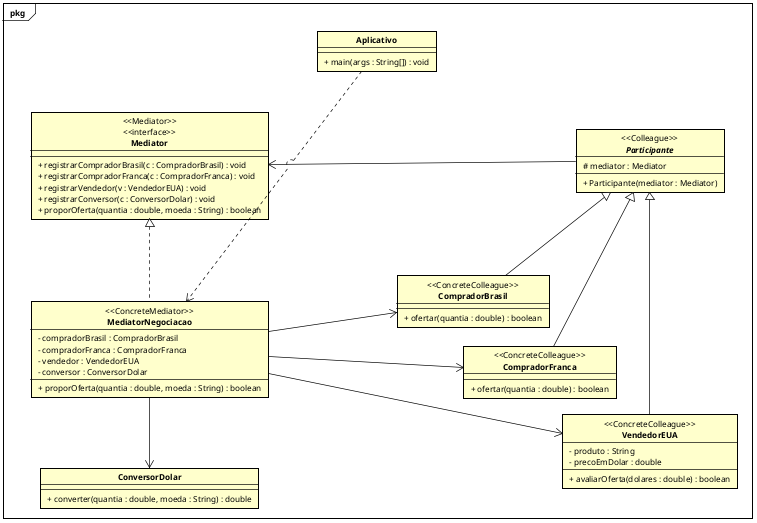

# Etapa 1 — Diagrama UML

O diagrama com os papéis do padrão Mediator:

- `Mediator`: Mediator
- `MediatorNegociacao`: ConcreteMediator
- `Participante`: Colleague
- `CompradorBrasil`, `CompradorFranca` e `VendedorEUA`: ConcreteColleague
- `ConversorDolar`: componente que só o Mediator usa pra converter as moedas
- `Aplicativo`: cria os participantes e registra no Mediator

  

## Próxima etapa

[v2-p1 — implementação e revisão crítica](https://github.com/Thalisson-Souza/APSOO-mediator/tree/v2-p1)
